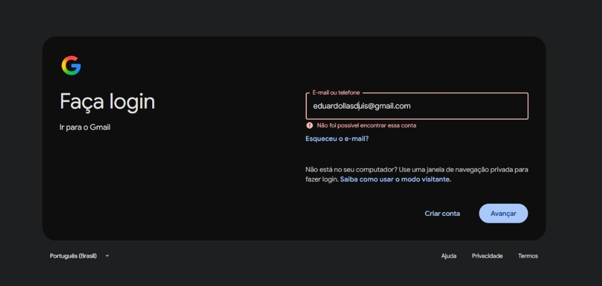

# Evidências

## CT-001 - Teste de Login
**Arquivo:** `CT-001-login.png`

**Descrição:** Teste negativo de login com conta inexistente
**Resultado:** Mensagem "Não foi possível encontrar essa conta" exibida corretamente
**Status:** Pass ✅

